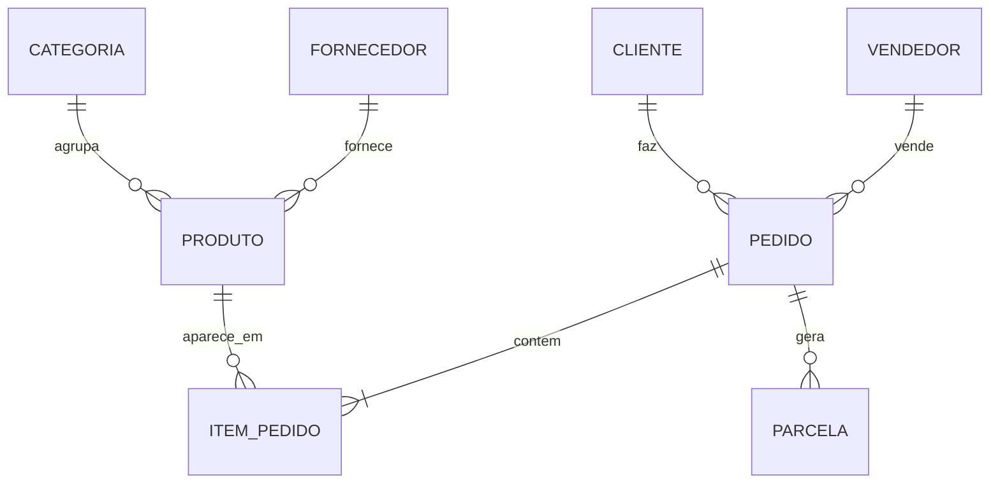

# Banco de Dados — Loja de Revestimentos 🧱

Projeto de banco de dados em **PostgreSQL** para uma loja que vende pisos, pedras e revestimentos.

Criei as tabelas, inseri dados de exemplo e escrevi consultas que respondem perguntas comuns do comercial e do financeiro, como *"quanto vendemos por mês?"*, *"quem está com parcela atrasada?"* e *"o que precisa ser reposto no estoque?"*.

> Todos os dados são fictícios.

## O que tem no projeto

- **8 tabelas** com chaves primárias, chaves estrangeiras e regras (`CHECK`) para evitar dados errados (ex.: preço negativo)
- **2 views** para reaproveitar consultas (total de cada pedido e contas a receber)
- **8 consultas de relatório** usando `JOIN`, `GROUP BY`, `HAVING`, `LEFT JOIN` e funções de data

## Diagrama



## Arquivos

| Arquivo | O que faz |
|---|---|
| `sql/01_schema.sql` | Cria as tabelas |
| `sql/02_views.sql` | Cria as views |
| `sql/03_dados.sql` | Insere os dados de exemplo |
| `sql/04_consultas.sql` | Consultas de relatório |

## Como rodar

Com o PostgreSQL instalado, rode os arquivos da pasta `sql/` em ordem (01, 02, 03, 04) no **pgAdmin** ou no **DBeaver**.

Ou pelo terminal:

```bash
git clone https://github.com/brenuuuu/sql-loja-revestimentos.git
cd sql-loja-revestimentos
bash executar.sh
```

## Consultas

| # | Pergunta |
|---|---|
| 1 | Quanto a loja faturou em cada mês e qual o ticket médio? |
| 2 | Quais são os 5 produtos que mais venderam? |
| 3 | Quanto cada categoria de produto faturou? |
| 4 | Quanto cada vendedor vendeu e quanto recebe de comissão? |
| 5 | Quais clientes estão com parcelas atrasadas? |
| 6 | Quanto a loja tem para receber nos próximos 90 dias? |
| 7 | Quais produtos estão com estoque abaixo do mínimo? |
| 8 | Quais clientes não compram há mais de 90 dias? |

**Exemplo de resultado (consulta 1):**

```
   mes   | pedidos | faturamento | ticket_medio
---------+---------+-------------+--------------
 2026-06 |       2 |    22023.30 |     11011.65
 2026-07 |       2 |    43280.00 |     21640.00
 2026-08 |       2 |    23677.10 |     11838.55
 2026-09 |       2 |    21348.70 |     10674.35
 2026-10 |       2 |    40248.00 |     20124.00
 2026-11 |       2 |    18002.90 |      9001.45
```

## Próximos passos

- [ ] Criar um trigger para baixar o estoque automaticamente a cada venda
- [ ] Montar um dashboard no Power BI conectado a esse banco

---

Feito por **Breno Oliveira**, estudante de Análise e Desenvolvimento de Sistemas na UNICID.
